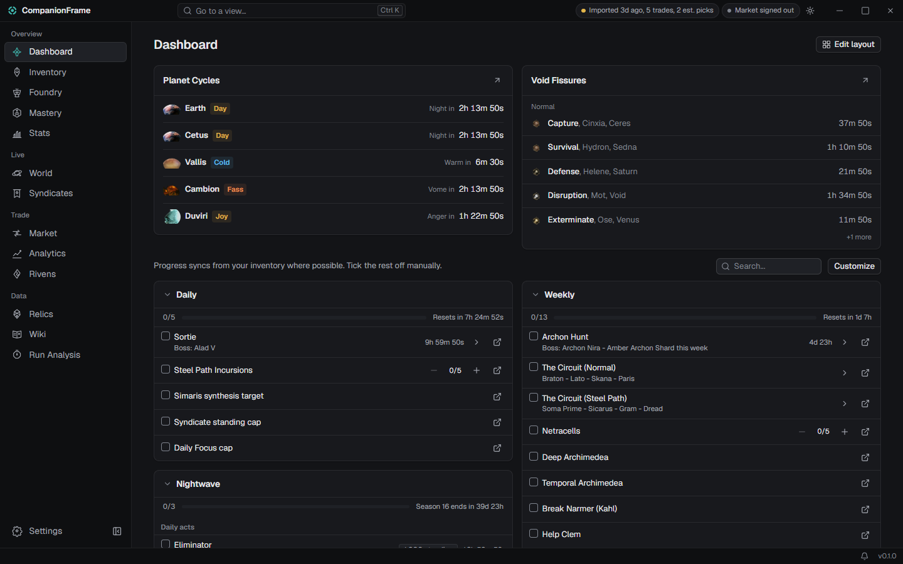
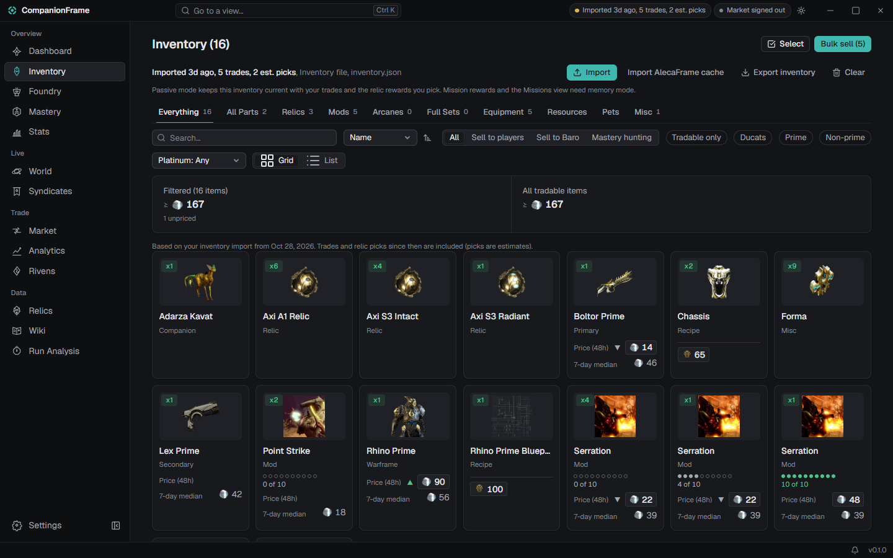
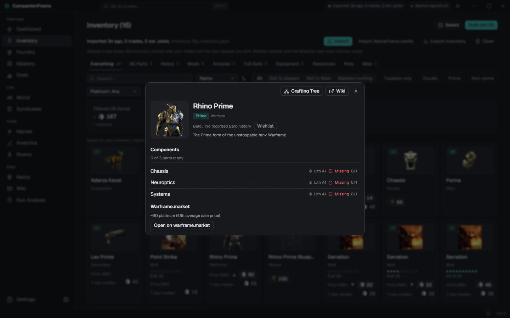
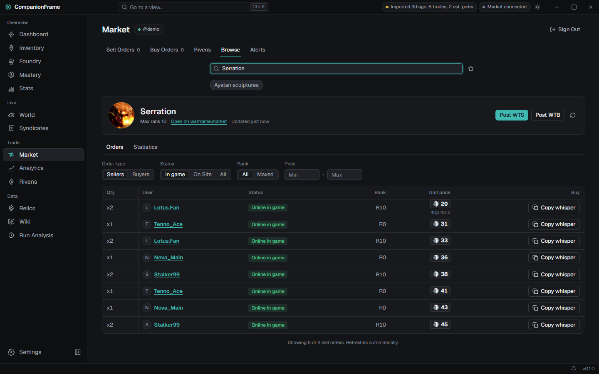
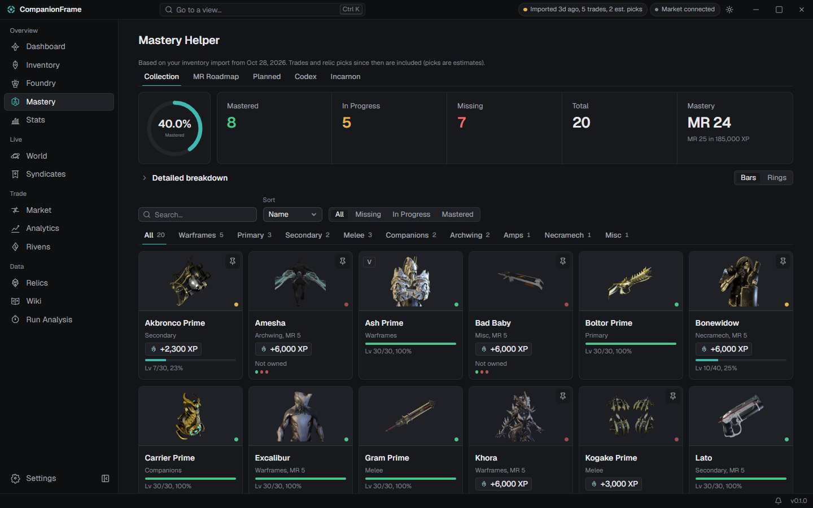
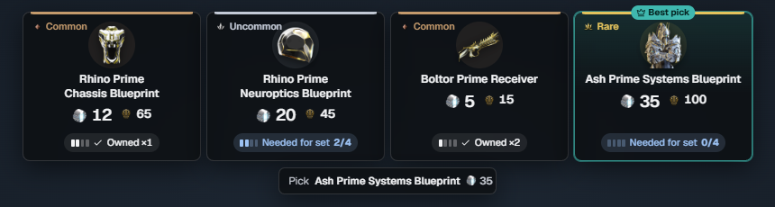

<h1 align="center">
   
  CompanionFrame
</h1>

CompanionFrame is a free, open-source desktop companion for Warframe. It tracks your inventory, mastery, warframe.market prices and world state, and puts in-game overlays on relic rewards and rivens. Not affiliated with Digital Extremes.

> **Unofficial.** CompanionFrame is not affiliated with, endorsed by or sponsored by Digital Extremes. Warframe is a trademark of Digital Extremes Ltd. See [NOTICE.md](NOTICE.md).

  
  
  
  
  
  

Everything runs locally on your PC: there is no CompanionFrame server. The app reads public sources directly, keeps local caches, and only reads the game (log, screen, and memory in the opt-in mode). It never modifies the game.

## Features

- **Inventory and mastery**: import an inventory JSON (file picker or drag and drop) or AlecaFrame's cache, or paste a public profile id. The snapshot is kept current with EE.log trades and the relic rewards you confirm. Mastery progress, foundry, resources and syndicates are built from it. Filter any tab by surplus copies (with how many can be sold, keeping one copy of each mod and arcane and what recipes, sets and goals need), filter mods and arcanes by duplicates, not max rank and not equipped, and optionally see where each is equipped. A tag marks items you have on sale.
- **Relics and drops**: relic and drop-table search with ducat and platinum values, plus a Wiki view.
- **World state**: cycles, fissures, Baro (with a planner and wishlist), Varzia alerts and the arbitration schedule.
- **warframe.market**: your orders (sort them by price, quantity, name or date, and select several to hide, show, reprice or delete them), riven auctions (including your decoded owned rivens), listing warnings, price history, alerts and bulk selling. Every write is a click of yours, except one opt-in setting (off by default) that closes the listings a finished trade matches; warframe.market's rules call automation a grey area, so turning it on is your call.
- **Trade ledger** fed live from `EE.log`, with GDPR export import.
- **Run analysis** for arbitrations and Profit-Taker, plus a missions view.
- **Overlays** (Windows): relic reward scan and planner, riven scan and grading, arbitration counter, trade notice (the listing a trade matches, closed with one click, and an optional thank-you message copied to the clipboard after a sale). Default hotkeys: F8 scan, F7 move overlays, F6 riven rescan (configurable).
- **Notifications**: toast, sound and Discord/generic webhooks.
- **Languages**: English, German, Spanish, French and Chinese.

## Data modes

| Mode | Default | What it uses |
|---|---|---|
| **EE.log + OCR** | yes | The game's `EE.log`, screen capture with OCR, and files you import. Nothing reads game memory. |
| **warframe-api-helper** | no | Optional download of [Sainan/warframe-api-helper](https://github.com/Sainan/warframe-api-helper) (pinned version, SHA-256 checked, never redistributed here) for a live inventory. It is part of memory mode. |
| **Game memory** | no | Reads the game's resident inventory and records mission rewards. Off until you tick an unchecked-by-default box under the disclaimer below (Setup or Settings > Inventory). |

> This project is not affiliated with or endorsed by Digital Extremes. Using tools that read game client memory may violate the Warframe Terms of Service and could result in action against your account. You use this software at your own risk.

CompanionFrame is a third-party tool. DE does not officially approve third-party software and reserves the right to act against tools it considers suspicious. The default mode lowers the risk (nothing reads the game's memory) but does not remove it.

## Requirements

- **Windows 10 or 11** with [WebView2](https://developer.microsoft.com/microsoft-edge/webview2/) (preinstalled on Windows 11; the installer bundles its bootstrapper). Windows is the full target.
- **Linux** builds and passes the test suite in CI, and the non-overlay parts work: UI, item/relic/drop data, world state, warframe.market, ledger, notifications, EE.log discovery (Steam Proton, Heroic, Lutris, Bottles, Wine) and run trackers. Overlays, screen capture, OCR scanners and memory mode are not available yet, and there are no Linux release packages.
- Run Warframe in borderless windowed mode for the overlays.

## Download / Install

Get the latest installer from the [Releases page](https://github.com/eldelahoz/CompanionFrame/releases): `CompanionFrame_<version>_x64-setup.exe` installs per user, with no admin rights. Requires Windows 10 or 11 and WebView2 (see Requirements). The installer wizard is available in English, German, Chinese and French; the app itself has five languages.

The installers are not code-signed yet, so Windows SmartScreen shows "Windows protected your PC / Unknown publisher". To continue, click **More info**, then **Run anyway**. You can compare the file with the source in this repository or build it yourself (below).

## Build from source

See [docs/DEVELOPMENT.md](docs/DEVELOPMENT.md): Rust (MSVC), Node 22 and pnpm 11, then `pnpm install` and `pnpm tauri dev`.

## Privacy

No account with us, no telemetry, no server of ours. Data stays on your PC:

- App data folder `com.companionframe.app` (`%APPDATA%` on Windows, `~/.local/share` on Linux): `companionframe.db` (SQLite: caches, price history, ledger, runs, inventory snapshot, alerts), `settings.json` and a few small JSON files (preferences, notification channels).
- Logs: `%LOCALAPPDATA%\com.companionframe.app\logs` (Windows) or `~/.local/share/com.companionframe.app/logs` (Linux), one file per day. The last 20 OCR scan captures are kept in its `scans` subfolder only if you turn that setting on.
- Your warframe.market login token and webhook URLs, in the OS credential store (Windows Credential Manager, Secret Service on Linux). Your password is never stored.

The app talks only to public sources (DE's public endpoints, warframe.market, WFCD/warframestat, browse.wf, npm/jsDelivr, a community riven sheet) and to the webhooks you configure. Update checks request one file, `latest.json` from github.com, and send nothing about you; you can turn them off in Settings > About. The full list is in [Architecture](docs/ARCHITECTURE.md#external-data-sources). Details and how to report a vulnerability: [SECURITY.md](SECURITY.md).

## Documentation

- [docs/README.md](docs/README.md): index of all docs
- [Architecture](docs/ARCHITECTURE.md): components, threads, IPC, services, persistence, data sources, security
- [Development](docs/DEVELOPMENT.md): setup, commands, testing, recipes
- [Contributing](CONTRIBUTING.md): reporting problems, commits, pull requests
- [Security policy](SECURITY.md)
- [Changelog](CHANGELOG.md)

## Support

CompanionFrame is free and always will be. If it saves you time and you want to say thanks, you can [buy me a coffee on Ko-fi](https://ko-fi.com/eldelahoz). Bug reports, ideas and pull requests help just as much.

## License and credits

[MIT](LICENSE). CompanionFrame began as a port of [WFHelper](https://github.com/WFHelper/WFHelper) (MIT; its copyright notice is kept in `LICENSE`). Game data comes from [warframe-public-export-plus](https://www.npmjs.com/package/warframe-public-export-plus) and [@wfcd/items](https://github.com/WFCD/warframe-items); market data from [warframe.market](https://warframe.market). Credits and data licenses are in [NOTICE.md](NOTICE.md).

Warframe and Digital Extremes are trademarks of Digital Extremes Ltd. Game art is not distributed in this repository.
