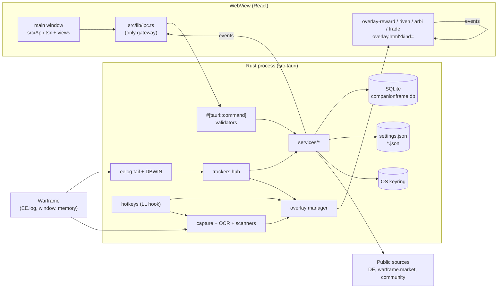
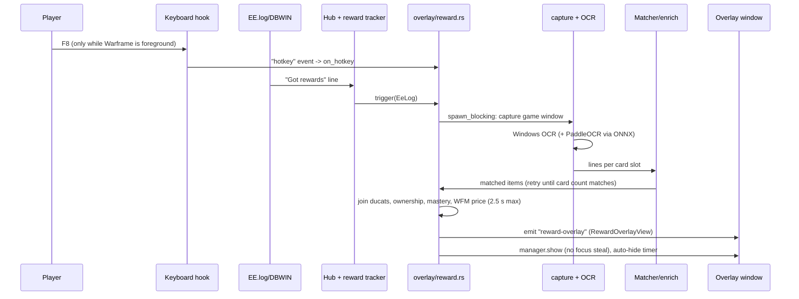
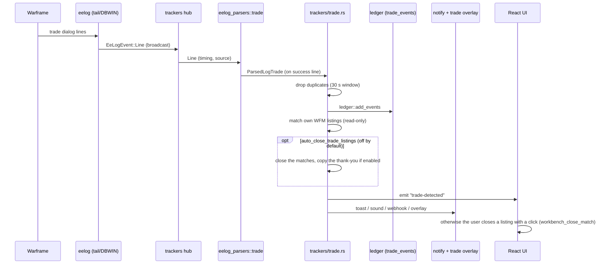
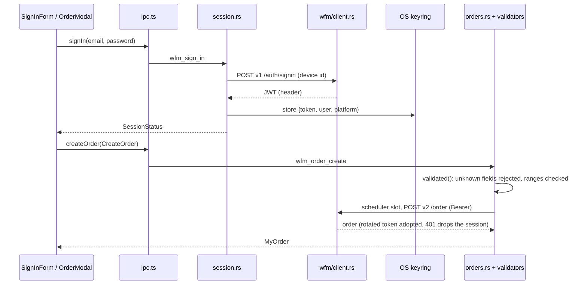

# Architecture

CompanionFrame is a desktop companion for Warframe: inventory and mastery tracking, relic and drop data, world state, warframe.market trading, a trade ledger, EE.log run trackers and in-game overlays (reward scan, riven scan, arbitration counter, trade notice).

Everything runs **on the user's PC**. There is no deployed backend of our own: the Rust process calls public sources directly (see [External data sources](#external-data-sources)) and keeps local caches. A test (`src-tauri/tests/no_wfhelper_hosts.rs`) fails if any source file names a host of the original WFHelper backend.

- **Shell and backend:** Tauri 2, Rust 2024 (`src-tauri/`), crate `companionframe_lib`.
- **Frontend:** React 19 + Vite + Tailwind 4 + TypeScript (`src/`), two HTML entries (`index.html`, `overlay.html`).
- **Persistence:** SQLite (rusqlite, bundled) for caches and history, atomic JSON files for settings, the OS keyring for the warframe.market token and webhook URLs.
- **Platforms:** Windows is the full target. Linux builds and runs the non-overlay parts (see [Platform layer](#platform-layer)).

## Components

## Process and threads

One OS process. Tauri owns the main thread and the WebView; everything else is a Tokio task (`tauri::async_runtime`, multi-thread runtime) or a dedicated thread.

| What | Where | Notes |
|---|---|---|
| Tauri runtime / main thread | `lib.rs` `run()` | Plugins: single-instance, dialog, notification, global-shortcut. `setup()` wires every service by hand (managed state). Window calls from other threads wait on this thread, so overlay commands are `async`. |
| Async tasks | `tauri::async_runtime::spawn` in each service | Pollers (world state 60 s, WFM presence/WebSocket, market alerts 3 min, arbitration schedule 1 h, relic data 6 h, helper 10 min in memory mode), the tracker hub, overlay flows. |
| Blocking work | `spawn_blocking` | OCR (WinRT blocks), ONNX inference, mastery/rivens data build, game-memory read (memory mode). Never on the async threads. |
| **EE.log tail thread** | `services/eelog/mod.rs` `run` | Polls the file every 500 ms plus a `notify` directory watcher; re-resolves the path every 5 s while missing, 60 s otherwise; broadcasts `EeLogEvent` on a `tokio::sync::broadcast` channel (cap 4096). |
| **DBWIN thread** (Windows) | `platform/windows/dbwin.rs` | Reads the game's `OutputDebugString` stream (live, seconds ahead of the file). High priority, acks early because the game blocks per line. Feeds the same broadcast with `Source::Dbwin`. |
| **Low-level keyboard hook thread** (Windows) | `platform/windows/hotkey.rs` | `WH_KEYBOARD_LL` with its own message loop. Decisions live in `services/hotkeys/matcher.rs`; a plain thread forwards results as the `hotkey` event. Falls back to `tauri-plugin-global-shortcut` if the hook cannot be installed. |
| Overlay watch loop | `services/overlay/mod.rs` `setup` | Task ticking every 250 ms (foreground follow, topmost) or 50 ms while click regions exist. |
| Helper threads | `notify/sound.rs` (audio), `notify/webhook.rs`, `inventory/commands.rs` (file watcher), `net.rs` | Small, short-lived or process-lifetime. |

Shared state is `app.manage(...)`d and read with `State<T>`: `Store` (settings), `Db` (one writer connection and three read-only ones, see Persistence), `Session` (WFM), `EeLog`, `Trackers`, `ItemDbState`, `Inventory`, overlay `Manager`, and so on.

## IPC

- **Commands:** Rust functions annotated `#[tauri::command] #[specta::specta]` and listed in `collect_commands![]` in `specta_builder()` (`src-tauri/src/lib.rs`). `tauri-specta` generates `src/bindings.ts` (types and a typed `commands` object).
- **Bindings:** `pnpm bindings` runs `src-tauri/examples/export_bindings.rs` (headless). `pnpm tauri dev` also rewrites the file on start. CI regenerates and fails on `git diff src/bindings.ts`, so commit it with the command.
- **Gateway:** `src/lib/ipc.ts` is the only module that imports `bindings.ts`, `invoke` or `listen`. It unwraps tauri-specta results (throws on error), narrows types (`Language`, `Theme`) and exposes `onXxx(cb)` subscriptions. Views and stores import from `lib/ipc`, never from Tauri.
- **Mock mode:** `inTauri()` checks `window.__TAURI_INTERNALS__`. Outside Tauri (plain `pnpm dev` in a browser, vitest) each function returns in-memory mock data (`src/lib/*/mock*.ts`, `lib/world/fixture`), so the UI can be developed and driven with Playwright without the game or the backend.
- **Events:** the backend `emit`s plain string events; `ipc.ts` wraps `listen`. Main ones: `inventory-updated`, `item-db-updated`, `game-locale-updated`, `relic-db-updated`, `world-state-updated`, `eelog-status-updated`, `game-running`, `game-login`, `trade-detected`, `arbi-run-saved`, `pt-run-saved`, `riven-session-saved`, `wfm-presence`, `wfm-orders-updated` (the whole new copy of my orders), `wfm-ws-status`, `wfm-ws-event`, `notification-added`, `workbench-updated`, `market-alerts-changed`, `helper-download-progress`, `mission-reward`, `hotkey`. Overlay payload events: `reward-overlay`, `riven-overlay`, `arbi-live`, `trade-overlay`, `relic-planner`, plus `overlay-settings`, `overlay-layout-reset`, `overlay-move-mode`, `overlay-content-visible`. Payload types used only by events are registered with `.typ::<T>()`.
- **Errors:** commands return `Result<T, String>` or a typed error (`WfmError`, `WebhookTestError`, …) that serializes to a tagged union.

## Backend services

All under `src-tauri/src/services/`, wired in `lib.rs` `setup()`. Pure logic is kept apart from IO so it is testable (`tests.rs` next to each module).

### Shared infrastructure
- **`db/mod.rs`**: SQLite open, the writer and reader connections, named migrations, the backup before a migration and the daily prune. **`store.rs`**: `Settings` JSON. **`atomic.rs`**: crash-safe write (tmp, fsync, rename). **`cache.rs`**: `kv_get`/`kv_get_many`/`kv_put` over `kv_cache` (JSON + timestamp; batched reads go in chunks of 500 keys); the `http_cache` table is still migrated but no code reads it, and only the daily prune touches it. **`net.rs`**: HTTP clients (UA `CompanionFrame/<ver>`, timeouts, body caps, HTTPS-only variant, ETag revalidation). **`tray.rs`**: the tray icon (left click shows or hides the main window; the menu has Show/Hide and Quit, in the app language). **`window_state.rs`**: window position and size, and what closing the window does: it exits the app unless `keep_running_on_close` is on, in which case the window hides and the tray keeps the process alive.

### Game data
- **Item database**: `item_db.rs`, `game_locale.rs`. Bundled data merged with DE's live export; English `name` is the join key, `displayName` is localized (DE dictionaries).
- **Public export**: `public_export.rs`. DE PublicExport (LZMA index, JSON manifests) as an overlay on the bundled data, cached in `kv_cache`.
- **Bundled data**: `bundled_data.rs`. Reads `resources/game-data` (copied by `scripts/copy-game-data.mjs` from `warframe-public-export-plus` and `@wfcd/items`).
- **Relics and drops**: `relics.rs` (relic groups by refinement), `relic_update.rs` (newer `@wfcd/items` from npm/jsDelivr, release must be ≥24 h old and not deprecated), `drop_data.rs` (WFCD drop tables, searchable), `spawn_nodes.rs` (star-chart nodes as spawn locations), `relic_planner/` (relic-selection overlay data).
- **World state**: `world_state/` (`fetch.rs` source chain, `parser.rs`, `regions.rs`, `steel_path.rs`, `notify.rs` for Baro/Varzia/cycles/fissure alerts), `arbi_schedule.rs` (community arbitration rota + alerts).

### Player data
- **Inventory**: `inventory/` (an imported snapshot plus deltas, see "Inventory sources" below: `store.rs` SQLite persistence, `delta.rs` applying EE.log trades and confirmed relic picks, `sync_marker.rs` EE.log sync markers, `aleca.rs` AlecaFrame cache reader, AlecaFrame file watcher thread), `stats/` (daily resource deltas). Memory mode only (`memory_gate.rs`): `inventory_sync.rs` (when background acquisition runs), `api_helper/` (pinned `warframe-api-helper` download with SHA-256 check, run, polling state machine; native fallback; each fetch is imported as the snapshot, source `helper`), `game_memory.rs` + `platform/windows/process.rs` (read-only read of the game's resident inventory and auth string), `mission_rewards/` (inventory diff after a mission).
- **Mastery / codex**: `mastery.rs` + `mastery/` (`classify.rs`, `ownership.rs`): mastery progress from the inventory snapshot.
- **Import**: `gdpr_import.rs` (DE trade export → ledger rows), `ledger.rs` (trade ledger).

### EE.log
- **Tail**: `eelog/` (`locate.rs` finds the log: manual path, `%LOCALAPPDATA%`, Proton/Wine prefixes; `tail.rs` handles truncation/restart). **Parsers**: `eelog_parsers/` (pure state machines: `arbi`, `profit_taker`, `trade`, `riven`, `lines`, `timing`, `sanitize`). **Hub**: `trackers/` (`hub.rs` is the only broadcast subscriber; stamps timing and source; fans out to `LineTracker`s: lifecycle, trade (one parser for the file lines and another for the DBWIN lines, so half-dialogs from the two never mix; item names in the game language, with or without a rank suffix such as "(RARE RANG 0)", are translated to English before the ledger row is written; riven names are not translated yet), inventory sync markers, riven, plus the run, mission-reward (memory mode) and overlay trackers). **Runs**: `runs/` (`arbi`, `pt`, shared `segment`/`store`; gzipped raw log per run). **Riven sessions and library**: `rivens/` (weapon data, grading, endo, best attributes, `riven_sessions` table).

### warframe.market (`wfm/`)
`client.rs` (HTTP, JWT on v1 / Bearer on v2, rotated-token adoption, no retries), `session.rs` (sign-in, keyring), `webview_login.rs` (optional sign-in through the site's own page), `ws.rs` (WebSocket, backoff), `presence.rs` + `live.rs` (online/ingame/invisible, wiring for the UI), `catalog.rs` + `riven_items.rs` (item and riven weapon lists; the parsed item catalog stays in memory on the client, `/versions` is asked once per 10 minutes and again, at most once a minute, when a lookup misses, and `kv_cache` is the copy for a cold start), `prices.rs` + `stats_v1.rs` + `stats_history.rs` (48 h average, 90-day history in `price_history`; bulk calls queue stale slugs for one background worker, latest request first), `orders.rs` + `validators.rs` (own orders, order book), `my_orders.rs` (the backend's copy of my orders: served at once, refreshed in the background, edited in place by every confirmed write, polled every 30 s while signed in and the window shows, paused during bulk runs, emptied on sign-out; announced as `wfm-orders-updated`; also hide/show a whole side with one `PATCH /v2/orders/group/all`), `contracts.rs` + `riven_search.rs` + `legacy_v1.rs` + `reviews.rs` + `profile_slug.rs` (riven auctions and +rep on the v1 API), `scheduler.rs` (the one budget for every request through `WfmClient`: token bucket 2.5 req/s, burst 5, 3 concurrent slots served Interactive > Job > Background with Background capped at 2, a 12/min bucket for contract and auction searches, one global gate after a 429 that fails fast for clicks and makes jobs and sweeps wait; `scheduler::scoped` sets the priority of the calls made inside it, and sign-in and the token probe are the only requests that skip it), `errors.rs`.
Related: `market_alerts/` (rules, store, 3-minute checker) and `workbench/` (bulk-sell plans with a write-ahead journal, trade-to-listing matcher; every mutation is a user click, except the opt-in auto-close of listings a trade matched). Own orders carry `createdAt` and `updatedAt` from the API.

### Scanners and overlays
- **Capture / OCR**: `capture/` (`GameWindow`; `CaptureKind::Fixture` is kept for tests), `platform/windows/capture.rs`, `platform/windows/ocr.rs` + `reward.rs` (Windows.Media.Ocr), `ocr_onnx/` (ONNX Runtime loaded dynamically from `resources/onnxruntime`; PaddleOCR recognizer + PP-OCRv5 DBNet stat-line detector).
- **Reward scan**: `reward_scan/` (card counter, slots, matcher, enrichment, retry flow, payload).
- **Riven scan**: `riven_scan/` (crop, detect, text → stats, weapon label; `fingerprint.rs` decodes the user's owned rivens for the `rivens_decoded` command and the Rivens view's Unveiled/Veiled tabs).
- **Overlay windows**: `overlay/` (`manager.rs` pure state machine, `host.rs` Tauri+Win32 host, `reward.rs`, `riven.rs`, `riven_analyzer.rs`, `arbi.rs`, `trade.rs`, `layout.rs`, `placement.rs`, `settings.rs`). **Hotkeys**: `hotkeys/` (accelerator parsing, matcher, registry).
- **Notifications**: `notify/` (toast, sound via rodio, Discord/generic webhooks, history capped at 200 rows, per-source routing).

## Frontend

- **Entries:** `index.html` → `src/main.tsx` → `App.tsx` (main window). `overlay.html` → `src/overlay.tsx`. Vite builds both (`vite.config.ts` `rollupOptions.input`).
- **Views** (`src/views/`): Dashboard, Inventory, Foundry, Mastery, Stats, World (cycles, Baro planner and wishlist in `stores/baro.ts`, arbitration schedule), Syndicates, Market (orders and contracts with listing-warning chips; the order table sorts by item, platinum, quantity, listed date or visible, selects rows with Shift+click ranges, and a floating bar hides, shows, reprices or deletes the selection with progress and a Stop button), MarketAnalysis, Relics, Rivens, Wiki (drop search), ArbiAnalyze, Missions, Settings, Setup. The sidebar list lives in `src/lib/viewRegistry.ts`; `App.tsx` switches on the active view (no router).
- **Components** (`src/components/<domain>/`): per-domain widgets on top of the design system: base components in `components/ui`, icons and game art in `components/icons`, tokens in `styles/tokens.css` (see `DESIGN.md`)
- **Stores** (`src/stores/`): small hooks over `ipc.ts` (item DB, inventory, WFM session, notifications, runs, world). They load once, subscribe to the matching event and reload. `stores/myOrders.ts` is the one copy of my warframe.market orders for Market, the inventory on-sale markers and the Workbench: it starts from the backend's cached copy and follows `wfm-orders-updated`. UI-only choices use `localStorage` through `lib/persistence.ts` / `usePersisted` (always try/catch).
- **Lib** (`src/lib/`): pure view logic (relic EV, market naming and repricing, run stats, mastery projection), mocks, `viewRegistry`, `i18n`.
- **Shared TS** (`config/shared/`): pure modules used by both UI and overlays (overlay layouts, reward presentation, notification kinds, WFM naming/validators, relic ordering). Imported with relative paths.
- **i18n:** `src/i18n/{en,es,fr,de,zh}.json`; `lib/i18n.ts` `translator(lang)` with `{param}` placeholders and English fallback. `MessageKey` is derived from `en.json`, so a missing key is a type error.
- **Overlays:** one Vite entry, four windows. `overlay.html?kind=reward|riven|arbi|trade` → `OverlayShell` (theme, opacity, i18n gate, interaction mode, draggable offset) around the screen in `src/overlays/screens.tsx`. Overlays are display-only: they receive their view through events (`overlayIpc.ts`) and use a few overlay commands. Overlays are placed in move mode (the Move overlays hotkey or the button in Settings): `overlays/common/MovablePanel.tsx` and `overlayDrag.ts` let the user drag each panel, and the position is saved per game resolution (`overlay/placement.rs`).

## Persistence

Data dir = Tauri `app_data_dir()` (`com.companionframe.app`); logs in `app_log_dir()` (daily `companionframe.log`; `COMPANIONFRAME_LOG` or `RUST_LOG` sets the filter).

- **SQLite** `companionframe.db` in WAL mode, so the folder also holds `companionframe.db-wal` and `companionframe.db-shm` while the app runs. `Db` (`db/mod.rs`) has one writer connection (`lock()`) and three read-only readers (`read()`, picked in rotation; read-only paths only, because a reader does not see a write that is still open). All connections set `busy_timeout` 5 s; the writer sets `synchronous=NORMAL` and `temp_store=MEMORY`; every connection sets a 256 MiB `mmap_size` and a 16 MB page cache. `foreign_keys` is left off on purpose, so deleting a parent row never cascades. In-memory test databases have no readers and read through the writer. `MIGRATIONS` in `src-tauri/src/db/mod.rs` is an append-only list of named, idempotent entries tracked in `schema_migrations`. Tables by domain:

| Domain | Tables |
|---|---|
| Caches | `meta`, `http_cache`, `kv_cache` |
| Items | `items`, `item_components` |
| Relics, drops, codex | `relics`, `relic_rewards`, `drop_sources`, `drop_rows`, `codex_scans` |
| Prices | `price_history` |
| Ledger | `trade_events` |
| EE.log runs | `runs`, `run_events`, `riven_sessions` |
| Notifications | `notification_log` |
| Market alerts | `market_alerts`, `market_alert_owned`, `market_alert_seen`, `alert_events` |
| Workbench | `workbench_intents`, `workbench_overrides`, `workbench_preexisting` |
| Inventory snapshot and deltas, stats | `inventory_snapshot`, `inventory_deltas`, `stats_daily` |
| Mission rewards (memory mode) | `mission_rewards`, `mission_reward_items` (dropped by `drop_mission_rewards`, re-created by `mission_rewards_restore`) |

- **Backups and pruning:** before a migration that is still pending on a database that already has tables, `VACUUM INTO` writes `<data dir>/backups/companionframe-<unix time>.db` and the 3 newest stay. If the backup fails, the start aborts, so a migration never runs without one. At startup, at most once a day, `wfm:price:*` entries in `kv_cache` and `http_cache` rows older than 30 days are deleted (user data is never pruned), then `PRAGMA optimize` runs.
- **Settings** `settings.json` (`store.rs`): language, theme, hotkeys, EE.log path, per-overlay layout/enabled/opacity, `data_source_mode` (`passive` default / `memory`), `memory_consent_at`, `auto_inventory_sync`. Partial or corrupt files fall back to defaults. Other small JSON files: `notification-channels.json`, `notification-sound.json`, `world-notify.json`, `codex-profile.json` (the public profile account id the user pasted, or in memory mode the one behind a working helper fetch), `wfm-device-id`, and in memory mode `api-helper/inventory.json`.
- **Keyring** (`keyring` crate: Windows Credential Manager, Secret Service on Linux): the WFM session (`com.companionframe.app` / `wfm-session`) and webhook URLs. If the keyring refuses, the login lives in memory only (`persistable: false`).
- **Never persisted:** the WFM password (zeroized after use), and the game's auth string (`accountId`/`nonce`): in passive mode it is never obtained; in memory mode it is read from memory or the helper, only formatted into the request to DE's own hosts, stripped from errors, and never stored, logged or sent anywhere else. The EE.log is read-only.

## Inventory sources

The inventory is **a snapshot plus deltas**, never a live read of the game. Consumers (`Inventory::current()`) see the snapshot with the deltas applied; the snapshot itself is never edited.

| Source | What it gives | Exactness |
|---|---|---|
| Inventory JSON file (file picker or drag and drop; the `inventory.json` shape, envelopes unwrapped) | Full snapshot | Exact at import time |
| AlecaFrame `lastData.dat` (fixed AES key and IV built into `inventory/aleca.rs`, no external key fetch; re-imported when the file changes) | Full snapshot | Exact at the time AlecaFrame saved |
| Public profile `getProfileViewingData.php` (account id the user pastes or takes from a profile link; saved in `codex-profile.json`) | Owned/ranked equipment, mastery, codex scans; no counts | Exact for what it covers |
| EE.log trades (`trackers/trade.rs` -> `inventory::apply_trade`) | Item and platinum deltas, only when the item resolves to a game path | Exact |
| Relic reward picks (reward overlay "I took this" -> `inventory_apply_pick`) | One copy of the OCR'd reward | **Estimated**, shown as such |
| warframe-api-helper fetch (memory mode only; `api_helper` -> `Inventory::import_helper`) | Full snapshot, source `helper`; same content keeps the deltas | Exact at fetch time |
| EE.log `SyncInventoryFromDB` / `LoginDone` | No data: only flags "your game synced since your last import, re-import for exact counts" | n/a |

Persistence: migration `inventory_snapshot` creates `inventory_snapshot` (one row) and `inventory_deltas`. A new import replaces the snapshot and deletes its deltas. The UI shows freshness (how long ago the import was and how many trades were applied since) in the titlebar pill and the Inventory header, and views that rely on counts say which import they are based on. Not covered: mission drops, purchases, crafting, foundry claims, vendor buys. They drift until the next import.

## External data sources

| Source | URL | Used for | Cache / limit |
|---|---|---|---|
| DE PublicExport | `content.warframe.com/PublicExport/` | live item overlay | `kv_cache`; failed refresh keeps the last copy |
| DE worldState | `content.warframe.com/dynamic/worldState.php` (`api.warframe.com/cdn/worldState.php`) | world state | polled every 60 s; falls back to the oracle |
| DE inventory (memory mode) | `api.warframe.com`, `mobile.warframe.com` `/api/inventory.php` | user's own inventory | helper poll ≥10 min; only with the user's auth |
| warframe-api-helper (memory mode) | `api.github.com/repos/Sainan/warframe-api-helper/releases` | optional inventory helper | pinned version, SHA-256 verified |
| warframe.market | `api.warframe.market/v2` (`v1` for statistics, auctions, reviews), WebSocket | catalog, orders, prices, presence | one scheduler 2.5 req/s (contract search 12/min); prices TTL 5 min; riven search 10 min; catalog on `/versions` change, checked every 10 min; my orders polled every 30 s; no retries |
| browse.wf / oracle | `browse.wf/arbys.txt`, `oracle.browse.wf` | arbitration rota, worldState fallback | rota hourly |
| WFCD | `drops.warframestat.us/data`, `api.warframestat.us/pc`, `cdn.warframestat.us/img` | drop tables, cycles fallback, images | drops in `kv_cache`, revalidated by `info.json` |
| npm / jsDelivr | `registry.npmjs.org/@wfcd%2Fitems`, `cdn.jsdelivr.net/npm/@wfcd/items` | newer relic data | every 6 h |
| 44bananas sheet | `docs.google.com/spreadsheets/d/…` | riven good rolls | 7 days |
| User webhooks | any HTTPS URL the user sets | Discord/generic notifications | HTTPS only, no private/reserved targets |

All outgoing requests go through `net.rs`/`wfm/client.rs` (identifiable UA, timeouts, body size caps). `https_client` rejects non-HTTPS including redirects.

## Platform layer

`src-tauri/src/platform/windows/` is the only place with Win32 `unsafe` (capture, DBWIN, game window, keyboard hook, overlay window styles, process memory, Windows OCR). `platform/mod.rs` exposes it under `#[cfg(windows)]`; services call it behind `cfg` and a non-Windows stub.

- **Windows:** everything.
- **Linux:** compiles and passes `cargo test` (CI job `ubuntu-22.04`). Works: UI, item/relic/drop data, world state, WFM, ledger, notifications, EE.log discovery (Steam Proton, Heroic, Lutris, Bottles, Wine) and tail, run trackers. Not yet: overlays, capture, OCR scanners, hotkey hook (global-shortcut fallback only), DBWIN, game-memory read. Tests needing `onnxruntime.dll` are `cfg(windows)`. Release packaging today is Windows NSIS only (`tauri.windows.conf.json`).

## Known gaps

`wfm_cookie.rs` is kept as a Cloudflare clearance helper (used by `wfm_images.rs` for warframe.market assets); it is not part of sign-in. Sign-in options are in [wfm-auth.md](wfm-auth.md).

## Security boundaries

- **Game memory is opt-in.** Two data-source modes (`Settings.data_source_mode`): `passive` (default; existing users stay on it) never reads another process's memory and never downloads or runs warframe-api-helper; the only process lookup is by executable name (ToolHelp snapshot). `memory` restores the helper, the native memory read and mission rewards. It needs `memory_consent_at`, set only when the user ticks an unchecked-by-default box under the disclaimer (Setup inventory step, Settings > Inventory; the disclaimer is also in About and the README):
  > This project is not affiliated with or endorsed by Digital Extremes. Using tools that read game client memory may violate the Warframe Terms of Service and could result in action against your account. You use this software at your own risk.

  The gate is `services/memory_gate.rs`: an atomic set from settings at startup and on every `set_settings` (which refuses `memory` without consent). It is checked by `game_memory::open_game` (the only caller of `platform::windows::process::open_warframe`, the only `OpenProcess(PROCESS_VM_READ)` / `ReadProcessMemory`), by each helper run, by `helper_run_now` / `helper_download` / `mission_rewards_set_tracking(true)` (clear error otherwise) and by the mission-reward tracker on every line and tick. Switching back to passive stops the helper poller at runtime (`InventorySync::apply("settings")`); no restart needed. `src-tauri/tests/memory_reading_is_gated.rs` fails if the read API or access flag appear outside `platform/windows/process.rs`, or if the opener is called anywhere but behind the gate; `memory_gate` has a unit test that it refuses without consent.

- **Capabilities** (`src-tauri/capabilities/`): `default.json` gives `main` and `overlay` `core:default`; each overlay window (`overlay-reward|riven|arbi|trade`) has its own file granting only `core:event:default`. CSP is currently `null` in `tauri.conf.json` (the WebView loads only bundled assets; remote images are plain ``).
- **Trust boundary:** the WebView is untrusted input. WFM payloads are typed structs with `deny_unknown_fields` and range checks (`wfm/validators.rs`: platinum ≤ 900 000, quantity ≤ 9 999, ids are 24 hex chars so they are safe in URL paths); `set_settings` validates hotkeys and overlay settings before saving and preserves backend-owned fields; layouts are size/JSON-checked (`overlay/layout.rs`); workbench payloads, webhook URLs and GDPR imports are validated in Rust.
- **Outward-facing writes are user actions:** orders, auctions, +rep and listing closes never run from a timer, with one exception. `trackers/trade.rs` matches read-only and closing is `workbench_close_match` (a click), unless the user turned on `auto_close_trade_listings` (off by default, with a warning in Settings that warframe.market treats automation as a grey area): then the tracker closes the listings a detected trade matched. +rep refuses unconfirmed names.
- **Secrets:** WFM token and webhook URLs in the keyring; passwords in `Zeroizing` buffers; request/response bodies never logged; errors are stripped of URLs (`reqwest::Error::without_url`, webhook and authz errors). In memory mode only: the helper exe is downloaded only from the pinned release and only runs if its SHA-256 is in the pin set; game memory access is read-only.
- **Platform integrity:** the app only reads the game (log, screen, and memory in the opt-in mode); it never writes to or injects into the game process.

## Data flows

### Reward scan

### Live trade

### Market sign-in and order

